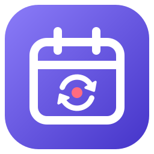
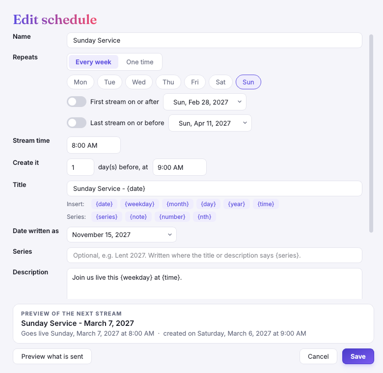
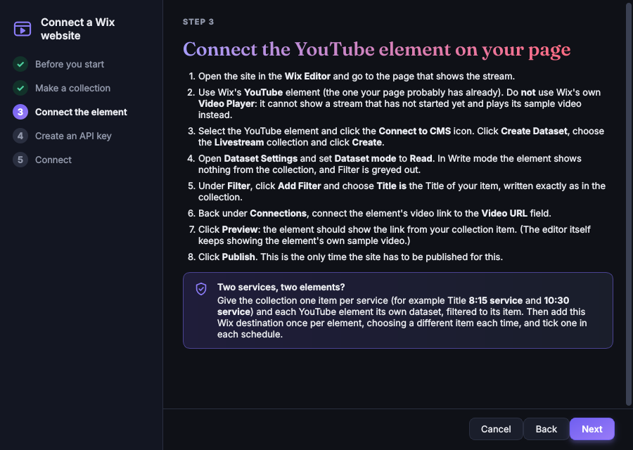

<p align="center"></p>
<h1 align="center">Stream Scheduler</h1>
<p align="center">Schedules your weekly live streams on <b>YouTube</b> by itself, with the date of each<br>
stream already in the title, shows the coming stream on your website, and tells you when one needs you.</p>

> **v0.0.7 alpha.** YouTube scheduling and the Wix website update are confirmed on a real channel and
> site. New in 0.0.7 is the look of the app, **not yet seen on a real Windows PC or Mac**. New since 0.0.5 and **not yet confirmed on real accounts**: alerts (email, Discord, Slack,
> Pushover), thumbnails, playlists and the other YouTube settings, cancelling a stream, WordPress and
> webhook destinations, and the notice of new versions. Please report what you find.


## What it does

- **Schedules that repeat.** "Every Sunday at 8:00 AM, created the Saturday before at 9:00 AM." Choose
  for each schedule which of your destinations it goes to.
- **Titles that fill in the date.** `Sunday Service - {date}` becomes *Sunday Service - March 7,
  2027* for that Sunday's stream. Also `{weekday}`, `{month}`, `{day}`, `{year}` and `{time}`, in the
  title and the description, with a choice of date formats.
- **One-time streams and series.** A schedule can be for a single date, such as Christmas Eve, or
  have a first and a last date, such as Wednesdays in Lent. `{series}`, `{number}` and `{nth}` write
  "Lent, week 2" by themselves.
- **Change one stream.** Give a single date another title, description, start time or thumbnail, a
  note (`{note}`), or skip it, without touching the schedule. If the stream already exists, it is
  changed on YouTube and the website. *Cancel* deletes a stream from YouTube.
- **Thumbnails and YouTube settings.** A thumbnail per schedule; who can watch, playlist, category,
  delay and stream key per channel, and who can watch and the playlist per schedule too.
- **Preview before it is sent.** *Preview what is sent* shows the title, description, time and every
  setting of the next streams, without sending anything.
- **Alerts.** Be told by email, Discord, Slack or Pushover when a stream could not be scheduled or a
  sign-in stopped working, with an optional weekly summary of what is in place.
- **Check and repair.** *Check now* sees whether every scheduled stream is still on YouTube and still
  shown on the website, and puts back what is missing. *Update now* sends one stream again.
- **Your website follows along.** After a stream is created on YouTube, a page of your Wix or
  WordPress site is pointed at it, or a web address of your choice is told (a webhook, for Zapier,
  Make and others).
- **Guided setup.** A step-by-step guide for every destination and every kind of alert explains what
  to click on the other side, and what each step means for your account's safety.
- **Backup and new versions.** Save everything but the sign-ins to one file and restore it, also on
  another computer. The app says when a newer version is out.
- **Sign-ins kept in the system keychain**, never in a file. See [SECURITY.md](SECURITY.md).
- **Runs quietly.** Stays in the tray, can start at login, and catches up on what it missed while the
  computer was off. Light and dark themes, in the look of the website; the small animations can be
  switched off in Settings.

| | |
|---|---|
|  |  |

## Install

Download from the **[Releases](../../releases)** page:

| Your computer | Download |
|---|---|
| Windows 10 or 11 (64-bit) | `Stream-Scheduler-Windows-Setup.exe` |
| Mac with Apple silicon (M1 or newer) | `Stream-Scheduler-macOS.zip` |
| Linux, 64-bit (Ubuntu 22.04 or newer) | `Stream-Scheduler-Linux-x86_64.tar.gz` |

**Windows.** Run **Stream-Scheduler-Windows-Setup.exe**. It installs for you alone, without an
administrator prompt, and can start the app each time you sign in to Windows. It isn't code-signed yet,
so if Windows says *"Windows protected your PC"*, click **More info** → **Run anyway**. To update, run
the newer Setup: your destinations, schedules and sign-ins are kept.

**Mac.** Unzip and drag **Stream Scheduler** to **Applications**. It isn't signed with an Apple
developer ID yet: the first time, click **Done**, open **System Settings → Privacy & Security**, and
click **Open Anyway** next to Stream Scheduler.

**Linux.** Unpack and run `Stream Scheduler/Stream Scheduler`.

Or run it from source with [Python](https://www.python.org/downloads/) 3.10 or newer:

```bash
git clone https://github.com/Leaven-Labs/Stream-Scheduler.git
```

```bash
cd Stream-Scheduler
```

```bash
pip install -r requirements.txt
```

```bash
python app.py
```

Then: **Destinations** → *Add YouTube* and, if you like, *Add a website* (10 to 15 minutes each, once),
**Schedules** → *New schedule*, and **Alerts** to be told when something needs you.

## How the automatic part works

The streams are created **by your computer**, at the time the schedule says, through the platforms'
official APIs. There is no server of ours. So the app has to run at that time:

- leave it open, or closed to the tray (the default), and switch on **Settings → Start when I log in**; or
- have your system's task scheduler run the program with `--run` (from source: `python app.py --run`), which creates what is due and exits.

If the computer was off, the app creates the missed streams the next time it runs, as long as the
stream is still more than 10 minutes away. A stream is never created twice.

## Good to know about the platforms

- **YouTube.** You create your own free Google Cloud project (the guide shows how). Set it to *In
  production*, or Google ends the sign-in every 7 days. Choose a stream key in the guide and your
  encoder keeps the same key every week. Live streaming must be enabled on the channel.
- **Wix.** Wix has no way for an outside app to edit an element on a page. The guide has you connect
  the page's YouTube element to a small CMS collection once (Wix's own Video Player cannot show a
  stream that has not started); the app then only changes the link in that
  collection, which is live at once. The schedule must also send to YouTube. Publishing the whole site
  after each update is an option, off by default, because it also publishes any unfinished edits.
- **WordPress.** The guide has you put a *synced pattern* on your page once and make an application
  password; the app then replaces what is in that pattern with the new YouTube video. Needs
  WordPress 5.6 or newer on https. Not yet confirmed on a live site.
- **Other websites (webhook).** The app sends each new stream's title, time and link as JSON to a web
  address, where an automation service (Zapier, Make) can update Squarespace or anything else.
  Squarespace itself offers no way for an app to change a page.
- **Thumbnails.** YouTube accepts custom thumbnails only from channels verified by phone
  (youtube.com/verify): JPG or PNG, at most 2 MB.
- **Alerts** are sent by this app from your computer, so they cannot tell you that the computer is
  off. The weekly summary is the check for that: no summary means the app is not running.
- **Facebook is switched off.** Facebook no longer lets an app like this one schedule a live video the
  way its Live Producer does: it refuses the scheduled-live request and the Page's persistent stream
  key. The app could only create an event with a one-off stream key, which does not suit volunteers.
  The code is kept (`facebook.py`) in case Meta opens this up again.

## Where your files are

| | |
|---|---|
| The program (Windows installer) | `%LOCALAPPDATA%\Programs\Stream Scheduler`, replaced by each update |
| Settings, schedules, history | Windows `%APPDATA%\Stream Scheduler` · Mac `~/Library/Application Support/Stream Scheduler` · Linux `~/.config/stream-scheduler` |
| Tokens, client secrets, webhook addresses, the mail password | Windows Credential Manager · macOS Keychain · Linux Secret Service (GNOME Keyring, KWallet) |
| A backup | wherever you save it (Settings → Save a backup); it holds no sign-ins |

## Not in this alpha

Code signing; installers for Mac and Linux; running before anyone has signed in to the computer;
Facebook; a guide for Squarespace (use the webhook); other streaming platforms.

## For developers

Python and Qt (PySide6), standard library for HTTPS.

| File | What it holds |
|---|---|
| `app.py` | the start: the window, `--tray`, `--run`, `--quit`, `--uitest` |
| `tools/build.py`, `tools/installer.iss` | the downloads; the Windows installer (Inno Setup) |
| `engine.py` | which streams are coming, and creating the ones that are due |
| `recurrence.py`, `titles.py` | when streams are; filling `{date}` into titles |
| `youtube.py`, `wix.py`, `wordpress.py`, `webhook.py`, `net.py` | the platforms' APIs (`facebook.py` is kept but switched off) |
| `notify.py`, `updates.py` | alerts by email, Discord, Slack and Pushover; the look for a newer version |
| `vault.py`, `store.py` | secrets in the keychain; everything else in `config.json` |
| `ui.py`, `mainwindow.py`, `dialogs.py`, `wizards.py` | the look, the pages, the dialogs, the setup guides |

```bash
python -m unittest discover tests
```

```bash
python app.py --uitest
```

```bash
python tools/screenshots.py
```

To build the program for your own system (the Release workflow does this for all three and publishes
them):

```bash
pip install -r requirements-build.txt
```

```bash
python tools/build.py
```

## Security, license and credits

To report a security problem, please don't open a public issue: see [SECURITY.md](SECURITY.md).

Free software under the [MIT License](https://github.com/Leaven-Labs/Stream-Scheduler/blob/main/LICENSE): anyone may use, copy, change and share it, as long as the
copyright notice and license are kept with it.

Copyright (c) 2026 Aaron Steger. Published by [Leaven Labs](https://www.leavenlabs.org/). The app's
About box (Settings → About) shows the author, publisher, version and license.

YouTube and Facebook are trademarks of their owners; this app is not affiliated with or endorsed by
Google, Meta or Wix.
