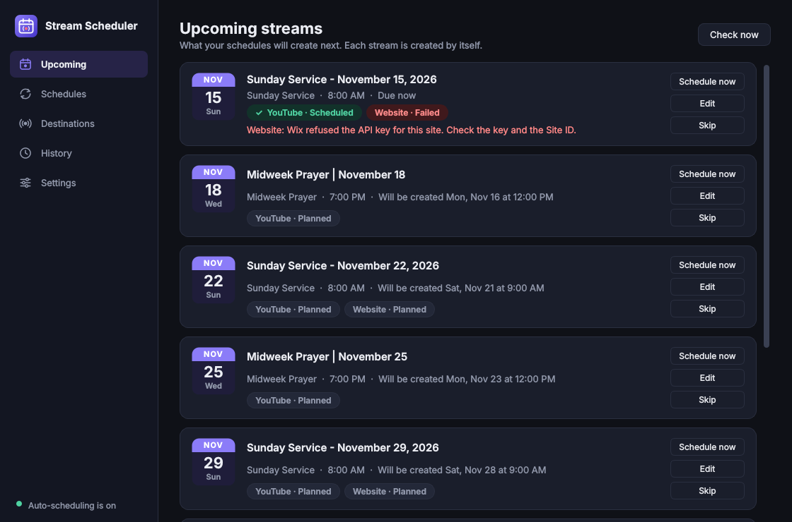
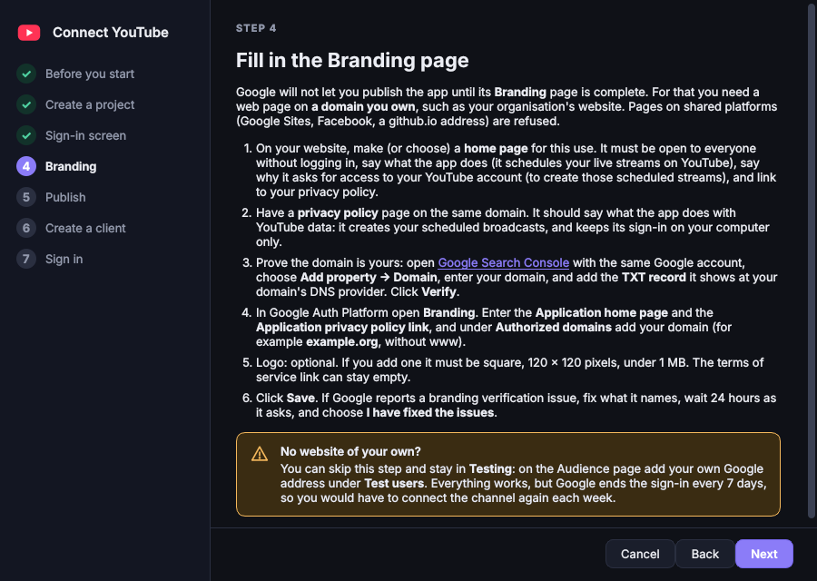

<p align="center"></p>
<h1 align="center">Stream Scheduler</h1>
<p align="center">Schedules your weekly live streams on <b>YouTube</b> and <b>Facebook</b> by itself,<br>
with the date of each stream already in the title.</p>

> **v0.0.0 alpha.** The scheduling logic is covered by tests, but the calls to YouTube and Facebook
> have **not yet been tried against real accounts**. Try it with an unlisted YouTube stream and a test
> Page first, and please report what you find.



## What it does

- **Schedules that repeat.** "Every Sunday at 8:00 AM, created the Saturday before at 9:00 AM." Choose
  for each schedule which of your destinations it goes to.
- **Titles that fill in the date.** `Sunday Service - {date}` becomes *Sunday Service - November 15,
  2027* for that Sunday's stream. Also `{weekday}`, `{month}`, `{day}`, `{year}` and `{time}`, in the
  title and the description, with a choice of date formats.
- **Override one stream.** Give a single date another title or description, or skip it, without
  touching the schedule.
- **Guided setup.** A step-by-step guide for YouTube and for Facebook explains what to click on
  Google's and Meta's pages, and what each step means for your account's safety.
- **Sign-ins kept in the system keychain**, never in a file. See [SECURITY.md](SECURITY.md).
- **Runs quietly.** Stays in the tray, can start at login, and catches up on what it missed while the
  computer was off. Light and dark themes.

| | |
|---|---|
|  |  |

## Run it

There is no installer yet. You need [Python](https://www.python.org/downloads/) 3.10 or newer.

```bash
git clone https://github.com/Leaven-Labs/Stream-Scheduler.git
```

```bash
cd Stream-Scheduler
```

```bash
pip install -r requirements.txt
```

```bash
python app.py
```

Then: **Destinations** → *Add YouTube* / *Add Facebook Page* (about ten minutes each, once), and
**Schedules** → *New schedule*.

## How the automatic part works

The streams are created **by your computer**, at the time the schedule says, through the platforms'
official APIs. There is no server of ours. So the app has to run at that time:

- leave it open, or closed to the tray (the default), and switch on **Settings → Start when I log in**; or
- have your system's task scheduler run `python app.py --run`, which creates what is due and exits.

If the computer was off, the app creates the missed streams the next time it runs, as long as the
stream is still more than 10 minutes away. A stream is never created twice.

## Good to know about the platforms

- **YouTube.** You create your own free Google Cloud project (the guide shows how). Set it to *In
  production*, or Google ends the sign-in every 7 days. Choose a stream key in the guide and your
  encoder keeps the same key every week. Live streaming must be enabled on the channel.
- **Facebook.** You create your own free Meta app and an access key for your Page. Facebook accepts a
  stream at most 7 days ahead (so a schedule creates it at most 6 days before). The app asks Facebook
  to use the Page's **persistent stream key** for each stream, so the encoder keeps one key; this is
  on by default per Page and not yet confirmed on a real Page. If Facebook refuses, the stream is still
  created with its own key, which you can copy from the **History** page. Switch the Meta app to
  *Live* mode, or only you can see what it posts.

## Where your files are

| | |
|---|---|
| Settings, schedules, history | Windows `%APPDATA%\Stream Scheduler` · Mac `~/Library/Application Support/Stream Scheduler` · Linux `~/.config/stream-scheduler` |
| Tokens and client secrets | Windows Credential Manager · macOS Keychain · Linux Secret Service (GNOME Keyring, KWallet) |

## Not in this alpha

Installers; thumbnails; one-off (non-weekly) streams; changing or deleting a stream on the platform
after it was created; other platforms.

## For developers

Python and Qt (PySide6), standard library for HTTPS.

| File | What it holds |
|---|---|
| `app.py` | the start: the window, `--tray`, `--run`, `--uitest` |
| `engine.py` | which streams are coming, and creating the ones that are due |
| `recurrence.py`, `titles.py` | when streams are; filling `{date}` into titles |
| `youtube.py`, `facebook.py`, `net.py` | the platforms' APIs |
| `vault.py`, `store.py` | secrets in the keychain; everything else in `config.json` |
| `ui.py`, `mainwindow.py`, `dialogs.py`, `wizards.py` | the look, the pages, the dialogs, the setup guides |

```bash
python -m unittest discover tests
```

```bash
python app.py --uitest
```

```bash
python tools/screenshots.py
```

## License

MIT, see [LICENSE](LICENSE). YouTube and Facebook are trademarks of their owners; this app is not
affiliated with or endorsed by Google or Meta.
